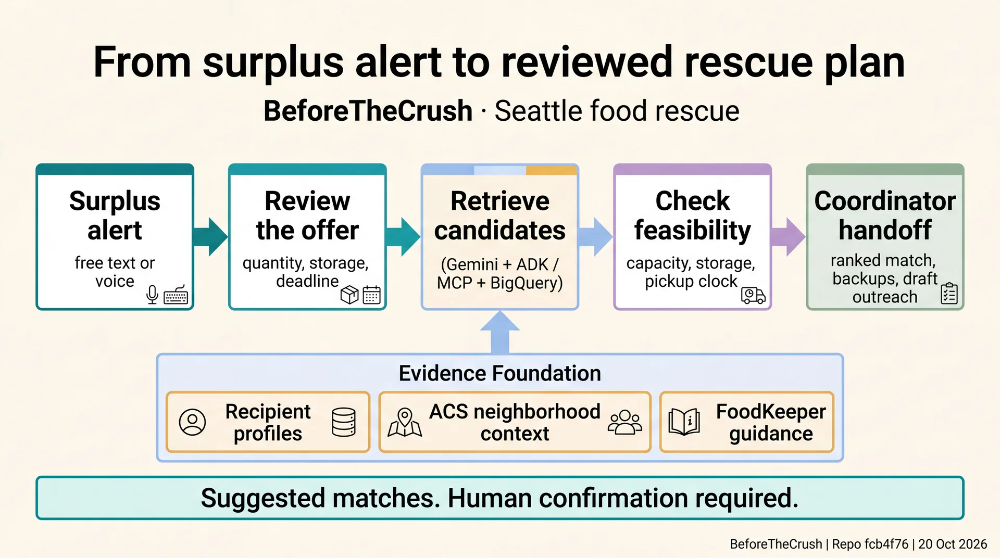
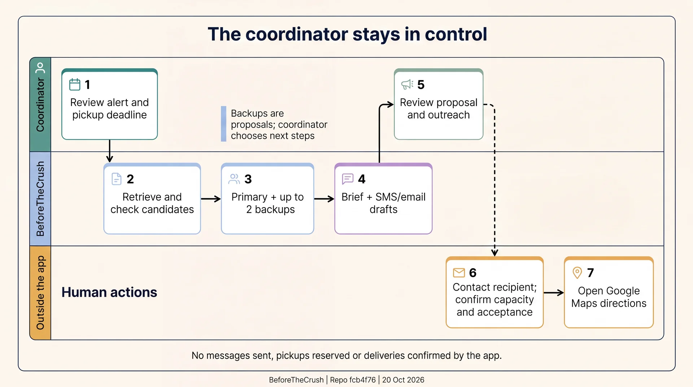
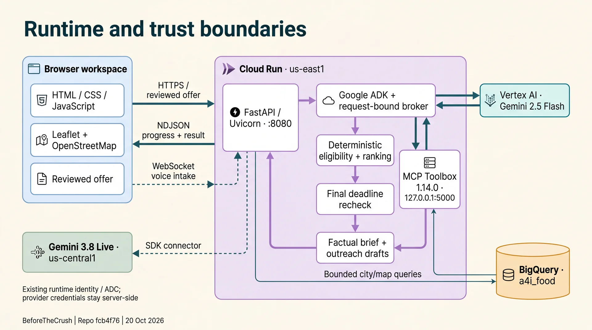
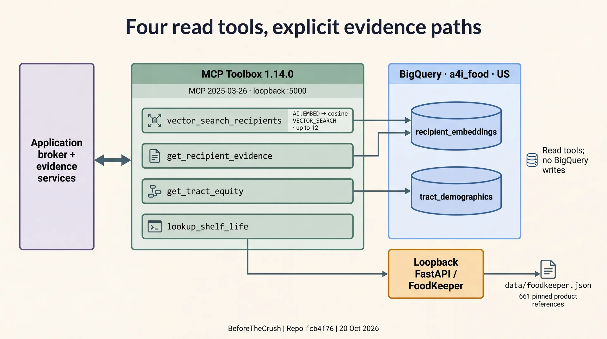
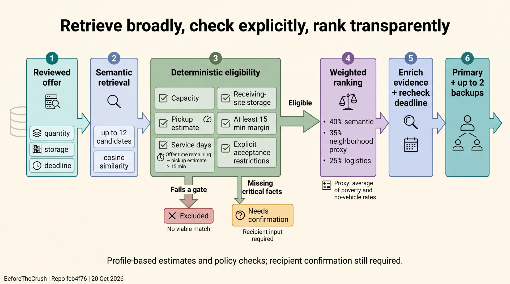
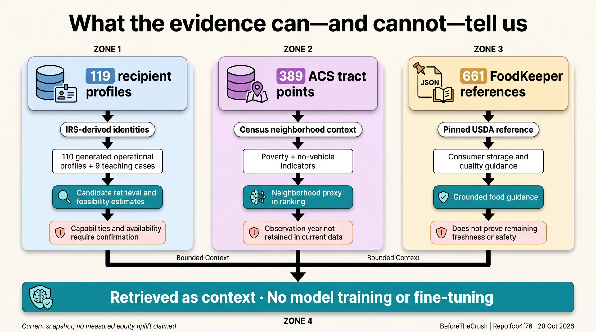

# BeforeTheCrush architecture gallery

[← Repository overview](../../README.md) · [Download all web packs](downloads/BeforeTheCrush-web.zip) · [Contact sheet](contact-sheet.jpg)

Six diagrams explain the Seattle food-rescue broker in three packs: the pitch, the technical architecture and the research method. Each figure links to a readable 1920 × 1072 WebP, with JPEG and smaller WebP variants available below it.

These diagrams document [repository snapshot `fcb4f76`](https://github.com/niatalwalkar/food-equity/tree/fcb4f76678713c55af3873acfc21e2871f44bcc7) from **20 October 2026**. They describe the source implementation; they do not establish the current live deployment. The app proposes matches, backups and outreach drafts. A coordinator confirms recipient capacity, acceptance and execution.

| Pack | What it explains | Download |
| --- | --- | --- |
| [Pitch](#pitch-pack) | A clear system overview and the coordinator’s role. | [Pitch web ZIP](downloads/BeforeTheCrush-01-pitch-web.zip) |
| [Technical](#technical-pack) | Runtime boundaries and the four tool-to-evidence paths. | [Technical web ZIP](downloads/BeforeTheCrush-02-technical-web.zip) |
| [Research](#research-pack) | Decision methodology and the limits of each evidence source. | [Research web ZIP](downloads/BeforeTheCrush-03-research-web.zip) |

The six 1920px WebPs total **663 KB**. All 18 image variants total **2.81 MB**. [The web manifest](web/manifest.json) records dimensions, file sizes and SHA-256 checksums.

## Pitch pack

A clear system overview and the coordinator’s role.

### From surplus alert to reviewed rescue plan

A reviewed surplus offer moves through candidate retrieval and feasibility checks to a coordinator handoff. Evidence informs the proposal; a person confirms the next step.

[1920px WebP · 116 KB](web/01-pitch/01-pitch-overview-1920.webp) · [1920px JPEG · 319 KB](web/01-pitch/01-pitch-overview-1920.jpg) · [1280px WebP · 74 KB](web/01-pitch/01-pitch-overview-1280.webp)

### The coordinator stays in control

The system prepares a primary match, up to two backups and outreach drafts. The coordinator contacts recipients to confirm capacity and acceptance, then opens directions.

[1920px WebP · 81 KB](web/01-pitch/02-human-handoff-1920.webp) · [1920px JPEG · 225 KB](web/01-pitch/02-human-handoff-1920.jpg) · [1280px WebP · 50 KB](web/01-pitch/02-human-handoff-1280.webp)

## Technical pack

Runtime boundaries and the four tool-to-evidence paths.

### Runtime and trust boundaries

The browser connects to the Cloud Run FastAPI service. The broker uses Vertex AI and loopback MCP Toolbox; the optional Live voice lane stages input for review.

[1920px WebP · 107 KB](web/02-technical/03-runtime-architecture-1920.webp) · [1920px JPEG · 278 KB](web/02-technical/03-runtime-architecture-1920.jpg) · [1280px WebP · 67 KB](web/02-technical/03-runtime-architecture-1280.webp)

### Four read tools, explicit evidence paths

Four read tools expose recipient retrieval, exact recipient evidence, tract context and pinned FoodKeeper guidance. FoodKeeper is a local reference, separate from BigQuery.

[1920px WebP · 87 KB](web/02-technical/04-mcp-data-topology-1920.webp) · [1920px JPEG · 244 KB](web/02-technical/04-mcp-data-topology-1920.jpg) · [1280px WebP · 53 KB](web/02-technical/04-mcp-data-topology-1280.webp)

## Research pack

Decision methodology and the limits of each evidence source.

### Retrieve broadly, check explicitly, rank transparently

Explicit checks cover capacity, storage, service, acceptance and the pickup clock. Missing facts are flagged for confirmation; eligible candidates are ranked, enriched with evidence and rechecked.

[1920px WebP · 127 KB](web/03-research/05-decision-method-1920.webp) · [1920px JPEG · 305 KB](web/03-research/05-decision-method-1920.jpg) · [1280px WebP · 79 KB](web/03-research/05-decision-method-1280.webp)

### What the evidence can—and cannot—tell us

Recipient profiles, neighborhood context and FoodKeeper references support retrieval and guidance, with explicit limits on what each source establishes.

[1920px WebP · 145 KB](web/03-research/06-data-provenance-1920.webp) · [1920px JPEG · 366 KB](web/03-research/06-data-provenance-1920.jpg) · [1280px WebP · 91 KB](web/03-research/06-data-provenance-1280.webp)

## Evidence and reuse

- [Verified architecture](source/VERIFIED-ARCHITECTURE.md) and [claim references](source/claims.json) connect the diagrams to the audited source.
- [Captions](CAPTIONS.md) provide reusable descriptions; [generation provenance](provenance.json) records the image workflow and artifact history.
- [Responsive HTML snippets](web/responsive-images.html) provide `picture` and `srcset` examples for reusing the compressed assets.

The diagrams were generated with Nano Banana Pro through the existing ResearchGravity PaperBanana-style planning and critique workflow. Image generation used the saved student-project credential through the Gemini Developer API, separately from the app’s Vertex AI runtime.

This Markdown gallery renders directly on GitHub. For the alternate card layout, clone or download the repository and open [index.html](index.html) locally; GitHub displays that HTML file as source. The repository contains the compressed image variants and web ZIPs. The full-resolution PNG masters remain in the original delivery pack.
